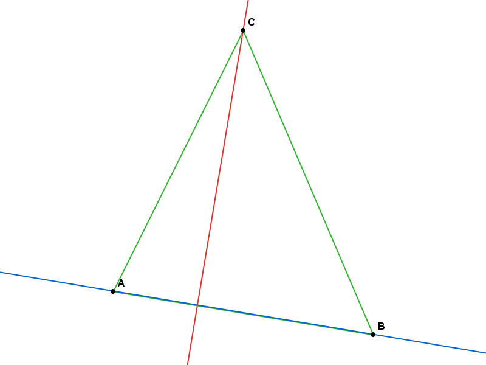
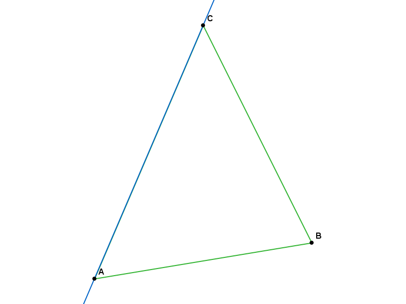
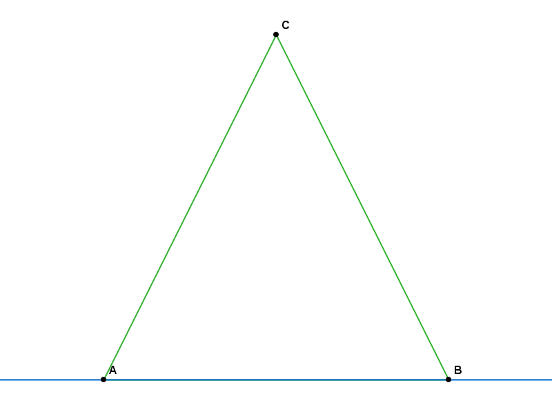

# Транслятор геометричної DSL (Лабораторна робота №2)

Цей проєкт є реалізацією фрагменту україномовної мови опису геометричних побудов на площині.
Програма зчитує текстовий файл, перевіряє його синтаксис та логіку, і генерує відповідне зображення у форматі PNG.

## Підтримувані команди
Мова підтримує такі конструкції:
* `ТОЧКА <Ім'я> (<x>, <y>)` — оголошення точки з координатами.
* `ПРОВЕСТИ ПРЯМУ ЧЕРЕЗ <Точка1>, <Точка2>` — проведення нескінченної прямої.
* `ПОБУДУВАТИ ПЕРПЕНДИКУЛЯР ДО ПРЯМОЇ (<Точка1>, <Точка2>) В ТОЧЦІ <Точка3>` — побудова перпендикуляра.
* `ПОБУДУВАТИ ТРИКУТНИК ПО ТРЬОМ ВЕРШИНАМ <Точка1>, <Точка2>, <Точка3>` — побудова трикутника.
* `ПОБУДУВАТИ ВІДРІЗОК ВІД <Точка1> ДО <Точка2>` — побудова відрізка.
* `ПОБУДУВАТИ ВІДРІЗОК ВІД <Точка1> ДО <Точка2>` — побудова відрізка.

Особливість: мова нечутлива до відмінків слів завдяки використанню **основ слів** у лексичному аналізаторі (наприклад, `ТОЧК` для "точка", "точки", а `ТОЧЦ` для "точці").

## Архітектура проєкту
Проєкт реалізований мовою Java і складається з таких етапів (пакетів):
1. **`lexer`**: Лексичний аналізатор. Розбиває текст на токени, розпізнає ключові слова за основами, числа, ідентифікатори та пунктуацію.
2. **`parser`**: Синтаксичний аналізатор (низхідний метод рекурсивного спуску). Перевіряє правильність граматики та будує дерево.
3. **`ast`**: Абстрактне синтаксичне дерево (AST) на базі `sealed interface` та `record`.
4. **`sema`**: Семантичний аналізатор. Перевіряє геометричну логіку (чи існують точки, чи не збігаються вони, чи не є трикутник виродженим) та створює математичну модель `GeometryModel`.
5. **`render`**: Рендерер. Використовує `Java2D` для малювання. Клас `Viewport` автоматично масштабує координати та інвертує вісь Y для правильного відображення.

## Як запустити
1. Переконайтеся, що у корені проєкту є файл `input.geo` (кодування UTF-8).
2. Запустіть метод `main` у класі `Main`.
3. У корені проєкту з'явиться файл `output.png` із результатом.

## Приклад вхідного файлу (`input.geo`)
```text
ТОЧКА A (1, 2)
ТОЧКА B (5, 2)
ТОЧКА C (3, 5)
ПРОВЕСТИ ПРЯМУ ЧЕРЕЗ A, B
ПОБУДУВАТИ ПЕРПЕНДИКУЛЯР ДО ПРЯМОЇ (A, B) В ТОЧЦІ C
ПОБУДУВАТИ ТРИКУТНИК ПО ТРЬОМ ВЕРШИНАМ A, B, C
```

## Результати тестування

У рамках тестування було перевірено різні геометричні конфігурації, включаючи похилі прямі, від'ємні координати, дробові числа та великі масштаби.

### 1. Базовий тест (Прямокутний трикутник)
**Вхідні дані (`test_1.geo`):**
```text
ТОЧКА A (0, 0)
ТОЧКА B (6, 0)
ТОЧКА C (0, 8)
ПРОВЕСТИ ПРЯМУ ЧЕРЕЗ A, B
ПОБУДУВАТИ ПЕРПЕНДИКУЛЯР ДО ПРЯМОЇ (A, B) В ТОЧЦІ C
ПОБУДУВАТИ ТРИКУТНИК ПО ТРЬОМ ВЕРШИНАМ A, B, C
```
**Результат:**
Демонструє базову роботу команд побудови прямої, трикутника та перпендикуляра.


---

### 2. Похила пряма (Перевірка векторної математики)
**Вхідні дані (`test_2.geo`):**
```text
ТОЧКА A (-4, -1)
ТОЧКА B (2, -2)
ТОЧКА C (-1, 5)
ПРОВЕСТИ ПРЯМУ ЧЕРЕЗ A, B
ПОБУДУВАТИ ПЕРПЕНДИКУЛЯР ДО ПРЯМОЇ (A, B) В ТОЧЦІ C
ПОБУДУВАТИ ТРИКУТНИК ПО ТРЬОМ ВЕРШИНАМ A, B, C
```
**Результат:**
Демонструє, що перпендикуляр будується математично точно (під кутом 90 градусів), навіть якщо базова пряма має кут.


---

### 3. Від'ємні та дробові координати
**Вхідні дані (`test_3.geo`):**
```text
ТОЧКА A (-3.5, -2.5)
ТОЧКА B (2.5, -1.5)
ТОЧКА C (-0.5, 4.5)
ПРОВЕСТИ ПРЯМУ ЧЕРЕЗ A, C
ПОБУДУВАТИ ТРИКУТНИК ПО ТРЬОМ ВЕРШИНАМ A, B, C
```
**Результат:**
Демонструє коректну роботу `Viewport` із від'ємними числами та зсувом системи координат.


---

### 4. Симетрія (Рівнобедрений трикутник)
**Вхідні дані (`test_4.geo`):**
```text
ТОЧКА A (1, 1)
ТОЧКА B (9, 1)
ТОЧКА C (5, 6)
ПОБУДУВАТИ ТРИКУТНИК ПО ТРЬОМ ВЕРШИНАМ A, B, C
ПРОВЕСТИ ПРЯМУ ЧЕРЕЗ A, B
ПОБУДУВАТИ ПЕРПЕНДИКУЛЯР ДО ПРЯМОЇ (A, B) В ТОЧЦІ C
```
**Результат:**
Демонструє точність побудови: перпендикуляр з вершини `C` є висотою і ділить основу навпіл.


---

### 5. Масштабування (Великі числа)
**Вхідні дані (`test_5.geo`):**
```text
ТОЧКА A (100, 200)
ТОЧКА B (500, 200)
ТОЧКА C (300, 600)
ПРОВЕСТИ ПРЯМУ ЧЕРЕЗ A, B
ПОБУДУВАТИ ТРИКУТНИК ПО ТРЬОМ ВЕРШИНАМ A, B, C
```
**Результат:**
Демонструє роботу `Viewport`: попри великі координати, малюнок автоматично масштабується, щоб ідеально вміститися в екран. Візуально ідентичний попередньому тесту.


---

### 6. Додатковий комплексний тест
**Вхідні дані (`input.geo`):**
```text
ТОЧКА A (1, 2)
ТОЧКА B (5, 2)
ТОЧКА C (3, 5)
ПРОВЕСТИ ПРЯМУ ЧЕРЕЗ A, B
ПОБУДУВАТИ ПЕРПЕНДИКУЛЯР ДО ПРЯМОЇ (A, B) В ТОЧЦІ C
ПОБУДУВАТИ ТРИКУТНИК ПО ТРЬОМ ВЕРШИНАМ A, B, C
```
**Результат:**
Демонструє комбінацію всіх команд на інших координатах.


## Граматика мови (EBNF)

```ebnf
program      = { statement } ;
statement    = pointDecl | lineThrough | perpendicular | triangle | segment ;
pointDecl    = "ТОЧКА", identifier, "(", number, ",", number, ")" ;
lineThrough  = "ПРОВЕСТИ", "ПРЯМУ", "ЧЕРЕЗ", identifier, ",", identifier ;
perpendicular= "ПОБУДУВАТИ", "ПЕРПЕНДИКУЛЯР", "ДО", "ПРЯМОЇ", "(", identifier, ",", identifier, ")", "В", "ТОЧЦІ", identifier ;
triangle     = "ПОБУДУВАТИ", "ТРИКУТНИК", "ПО", "ТРЬОМ", "ВЕРШИНАМ", identifier, ",", identifier, ",", identifier ;
segment      = "ПОБУДУВАТИ", "ВІДРІЗОК", "ВІД", identifier, "ДО", identifier ;
identifier   = letter, { letter } ;
number       = [ "-" | "+" ], digit, { digit }, [ ".", digit, { digit } ] ;
```


### Приклад відрізка
```text
ТОЧКА A (0, 0)
ТОЧКА B (5, 5)
ПОБУДУВАТИ ВІДРІЗОК ВІД A ДО B
```


### Приклад відрізка
```text
ТОЧКА A (0, 0)
ТОЧКА B (5, 5)
ПОБУДУВАТИ ВІДРІЗОК ВІД A ДО B
```
