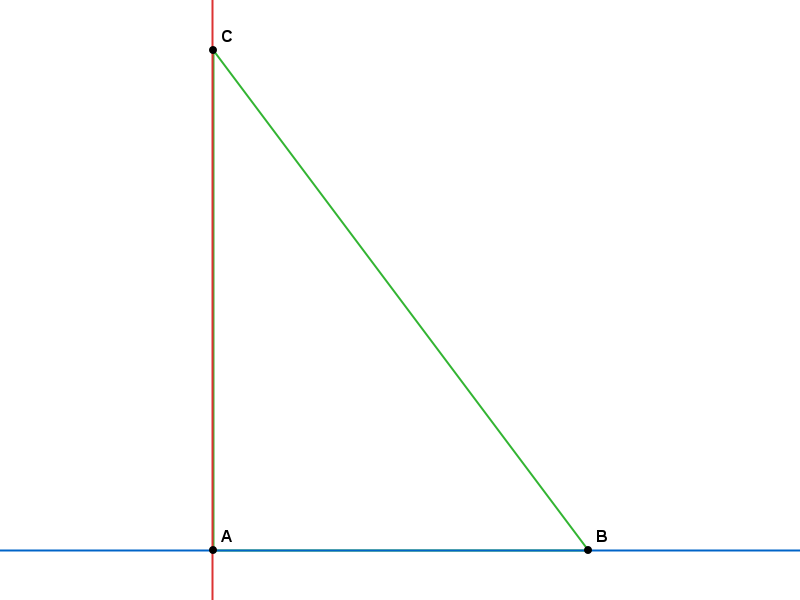

# Транслятор геометричної DSL (Лабораторна робота №2)

Цей проєкт є реалізацією фрагменту україномовної мови опису геометричних побудов на площині.
Програма зчитує текстовий файл, перевіряє його синтаксис та логіку, і генерує відповідне зображення у форматі PNG.

## Підтримувані команди
Мова підтримує такі конструкції:
* `ТОЧКА <Ім'я> (<x>, <y>)` — оголошення точки з координатами.
* `ПРОВЕСТИ ПРЯМУ ЧЕРЕЗ <Точка1>, <Точка2>` — проведення нескінченної прямої.
* `ПОБУДУВАТИ ПЕРПЕНДИКУЛЯР ДО ПРЯМОЇ (<Точка1>, <Точка2>) В ТОЧЦІ <Точка3>` — побудова перпендикуляра.
* `ПОБУДУВАТИ ТРИКУТНИК ПО ТРЬОМ ВЕРШИНАМ <Точка1>, <Точка2>, <Точка3>` — побудова трикутника.
* `ПОБУДУВАТИ ВІДРІЗОК ВІД <Точка1> ДО <Точка2>` — побудова відрізка.

Речення розділяються крапкою з комою (`;`), текст завершується символом `#`.

Особливість: мова нечутлива до відмінків слів завдяки використанню **основ слів** у лексичному аналізаторі
(наприклад, `ТОЧК` для "точка", "точки", а `ТОЧЦ` для "точці"). Перевірка конкретних закінчень не проводиться —
достатньо, щоб слово починалося з відомої основи.

## Архітектура проєкту
Проєкт реалізований мовою Java і складається з таких етапів (пакетів):
1. **`lexer`**: Лексичний аналізатор. Розбиває текст на токени, розпізнає ключові слова за основами, числа,
   ідентифікатори, пунктуацію та роздільники `;`/`#`. Веде єдину для всього тексту **таблицю ідентифікаторів**
   (`SymbolTable`) — кожне ім'я точки отримує код, що зберігається прямо в токені `IDENTIFIER`.
2. **`parser`**: Синтаксичний аналізатор (низхідний метод рекурсивного спуску, LL(1)). Будує явне **дерево
   синтаксичного розбору** (`ParseNode`), де кожен вузол відповідає нетерміналу граматики і має власний числовий
   код. Окремий клас `TreeFolder` згортає це дерево в зручніше для семантики представлення (`Stmt`).
3. **`ast`**: Містить два рівні дерева — `ParseNode` (буквальне дерево розбору за граматикою) і `Stmt`
   (спрощене AST для семантичного аналізу). Клас `ParseTreePrinter` друкує `ParseNode` з відступами й кодами
   нетерміналів — для наочної демонстрації структури дерева (наприклад, на захисті).
4. **`sema`**: Семантичний аналізатор. Перевіряє геометричну логіку (чи існують точки, чи не збігаються вони,
   чи не є трикутник виродженим) та створює математичну модель `GeometryModel`.
5. **`render`**: Розділений на дві незалежні стадії:
    * `CodeGenerator` обходить `GeometryModel` і генерує список команд графічного пакета (`GraphicsCommand`) —
      `DrawPoint`, `DrawSegment`, `DrawInfiniteLine`, `DrawPolygon` — у математичних координатах моделі, без
      жодної піксельної логіки.
    * `Renderer` — чистий виконавець цих команд через Java2D. Нічого не знає про трикутники, перпендикуляри чи
      прямі — вміє малювати лише чотири примітиви. Клас `Viewport` масштабує координати, інвертує вісь Y та
      обрізає нескінченні прямі по межах вікна.

## Як запустити
1. Переконайтеся, що у корені проєкту є файл `input.geo` (кодування UTF-8, речення розділені `;`, текст
   завершується `#`).
2. Запустіть клас `Main`: `java Main [input.geo] [output.png] [--tree]`.
    * Перші два аргументи необов'язкові (за замовчуванням `input.geo` і `output.png`).
    * Прапорець `--tree` (у будь-якій позиції) додатково друкує в консоль дерево синтаксичного розбору перед
      семантичним аналізом — зручно для демонстрації стадії побудови дерева.
3. У вказаному місці з'явиться PNG-файл із результатом.

## Приклад вхідного файлу (`input.geo`)
```text
ТОЧКА A (1, 2);
ТОЧКА B (5, 2);
ТОЧКА C (3, 5);
ПРОВЕСТИ ПРЯМУ ЧЕРЕЗ A, B;
ПОБУДУВАТИ ПЕРПЕНДИКУЛЯР ДО ПРЯМОЇ (A, B) В ТОЧЦІ C;
ПОБУДУВАТИ ТРИКУТНИК ПО ТРЬОМ ВЕРШИНАМ A, B, C
#
```

## Результати тестування

У рамках тестування було перевірено різні геометричні конфігурації, включаючи похилі прямі, від'ємні координати, дробові числа та великі масштаби.

### 1. Базовий тест (Прямокутний трикутник)
**Вхідні дані (`test_1.geo`):**
```text
ТОЧКА A (0, 0);
ТОЧКА B (6, 0);
ТОЧКА C (0, 8);
ПРОВЕСТИ ПРЯМУ ЧЕРЕЗ A, B;
ПОБУДУВАТИ ПЕРПЕНДИКУЛЯР ДО ПРЯМОЇ (A, B) В ТОЧЦІ C;
ПОБУДУВАТИ ТРИКУТНИК ПО ТРЬОМ ВЕРШИНАМ A, B, C
#
```
**Результат:**
Демонструє базову роботу команд побудови прямої, трикутника та перпендикуляра.


---

### 2. Похила пряма (Перевірка векторної математики)
**Вхідні дані (`test_2.geo`):**
```text
ТОЧКА A (-4, -1);
ТОЧКА B (2, -2);
ТОЧКА C (-1, 5);
ПРОВЕСТИ ПРЯМУ ЧЕРЕЗ A, B;
ПОБУДУВАТИ ПЕРПЕНДИКУЛЯР ДО ПРЯМОЇ (A, B) В ТОЧЦІ C;
ПОБУДУВАТИ ТРИКУТНИК ПО ТРЬОМ ВЕРШИНАМ A, B, C
#
```
**Результат:**
Демонструє, що перпендикуляр будується математично точно (під кутом 90 градусів), навіть якщо базова пряма має кут.


---

### 3. Від'ємні та дробові координати
**Вхідні дані (`test_3.geo`):**
```text
ТОЧКА A (-3.5, -2.5);
ТОЧКА B (2.5, -1.5);
ТОЧКА C (-0.5, 4.5);
ПРОВЕСТИ ПРЯМУ ЧЕРЕЗ A, C;
ПОБУДУВАТИ ТРИКУТНИК ПО ТРЬОМ ВЕРШИНАМ A, B, C
#
```
**Результат:**
Демонструє коректну роботу `Viewport` із від'ємними числами та зсувом системи координат.


---

### 4. Симетрія (Рівнобедрений трикутник)
**Вхідні дані (`test_4.geo`):**
```text
ТОЧКА A (1, 1);
ТОЧКА B (9, 1);
ТОЧКА C (5, 6);
ПОБУДУВАТИ ТРИКУТНИК ПО ТРЬОМ ВЕРШИНАМ A, B, C;
ПРОВЕСТИ ПРЯМУ ЧЕРЕЗ A, B;
ПОБУДУВАТИ ПЕРПЕНДИКУЛЯР ДО ПРЯМОЇ (A, B) В ТОЧЦІ C
#
```
**Результат:**
Демонструє точність побудови: перпендикуляр з вершини `C` є висотою і ділить основу навпіл.


---

### 5. Масштабування (Великі числа)
**Вхідні дані (`test_5.geo`):**
```text
ТОЧКА A (100, 200);
ТОЧКА B (500, 200);
ТОЧКА C (300, 600);
ПРОВЕСТИ ПРЯМУ ЧЕРЕЗ A, B;
ПОБУДУВАТИ ТРИКУТНИК ПО ТРЬОМ ВЕРШИНАМ A, B, C
#
```
**Результат:**
Демонструє роботу `Viewport`: попри великі координати, малюнок автоматично масштабується, щоб ідеально вміститися в екран. Візуально ідентичний попередньому тесту.


---

### 6. Додатковий комплексний тест
**Вхідні дані (`input.geo`):**
```text
ТОЧКА A (1, 2);
ТОЧКА B (5, 2);
ТОЧКА C (3, 5);
ПРОВЕСТИ ПРЯМУ ЧЕРЕЗ A, B;
ПОБУДУВАТИ ПЕРПЕНДИКУЛЯР ДО ПРЯМОЇ (A, B) В ТОЧЦІ C;
ПОБУДУВАТИ ТРИКУТНИК ПО ТРЬОМ ВЕРШИНАМ A, B, C
#
```
**Результат:**
Демонструє комбінацію всіх команд на інших координатах.


## Граматика мови (БНФ)

```
<текст>              ::= <список_речень> #
<список_речень>      ::= <речення> <продовження_списку>
<продовження_списку> ::= ; <список_речень> | <пусто>

<речення>            ::= <точка> | <пряма_через> | <перпендикуляр> | <трикутник> | <відрізок>

<точка>              ::= ТОЧКА <ім'я> ( <число> , <число> )
<пряма_через>        ::= ПРОВЕСТИ ПРЯМУ ЧЕРЕЗ <пара_імен>
<перпендикуляр>      ::= ПОБУДУВАТИ ПЕРПЕНДИКУЛЯР ДО ПРЯМОЇ ( <пара_імен> ) В ТОЧЦІ <ім'я>
<трикутник>          ::= ПОБУДУВАТИ ТРИКУТНИК ПО ТРЬОМ ВЕРШИНАМ <список_імен>
<відрізок>           ::= ПОБУДУВАТИ ВІДРІЗОК ВІД <ім'я> ДО <ім'я>

<список_імен>        ::= <ім'я> <продовження_імен>
<продовження_імен>   ::= , <список_імен> | <пусто>
<пара_імен>          ::= <ім'я> , <ім'я>
<ім'я>               ::= IDENTIFIER
<число>              ::= NUMBER
```

Примітка: `<пара_імен>` у нашій реалізації записується з комою (`A, B`), на відміну від буквального тексту
методички (`<ім'я> <ім'я>`) — це свідоме відхилення, узгоджене для власного обраного фрагмента мови.

### Приклад відрізка
```text
ТОЧКА A (0, 0);
ТОЧКА B (5, 5);
ПОБУДУВАТИ ВІДРІЗОК ВІД A ДО B
#
```