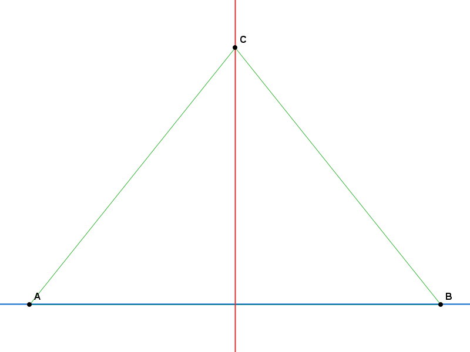
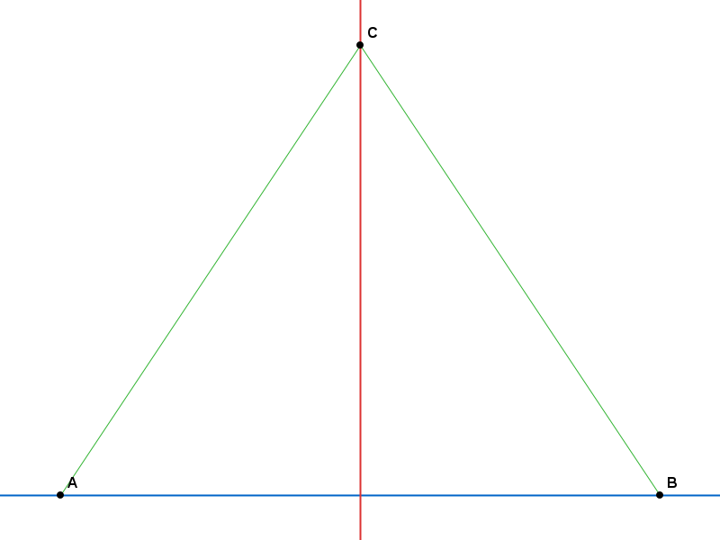

# Транслятор геометричної DSL (Лабораторна робота №2)

Цей проєкт є реалізацією фрагменту україномовної мови опису геометричних побудов на площині.
Програма зчитує текстовий файл, перевіряє його синтаксис та логіку, і генерує відповідне зображення у форматі PNG.

## Підтримувані команди
Мова підтримує такі конструкції:
* `ТОЧКА <Ім'я> (<x>, <y>)` — оголошення точки з координатами.
* `ПРОВЕСТИ ПРЯМУ ЧЕРЕЗ <Точка1>, <Точка2>` — проведення нескінченної прямої.
* `ПОБУДУВАТИ ПЕРПЕНДИКУЛЯР ДО ПРЯМОЇ (<Точка1>, <Точка2>) В ТОЧЦІ <Точка3>` — побудова перпендикуляра.
* `ПОБУДУВАТИ ТРИКУТНИК ПО ТРЬОМ ВЕРШИНАМ <Точка1>, <Точка2>, <Точка3>` — побудова трикутника.
* `ПОБУДУВАТИ ВІДРІЗОК ВІД <Точка1> ДО <Точка2>` — побудова відрізка.

Речення розділяються крапкою з комою (`;`), текст завершується символом `#`.

Особливість: мова нечутлива до відмінків слів завдяки використанню **основ слів** у лексичному аналізаторі
(наприклад, `ТОЧК` для "точка", "точки", а `ТОЧЦ` для "точці"). Перевірка конкретних закінчень не проводиться —
достатньо, щоб слово починалося з відомої основи.

## Архітектура проєкту
Проєкт реалізований мовою Java і складається з таких етапів (пакетів):
1. **`lexer`**: Лексичний аналізатор. Розбиває текст на токени, розпізнає ключові слова за основами, числа,
   ідентифікатори, пунктуацію та роздільники `;`/`#`. Веде єдину для всього тексту **таблицю ідентифікаторів**
   (`SymbolTable`) — кожне ім'я точки отримує код, що зберігається прямо в токені `IDENTIFIER`.
2. **`grammar`**: Граматика як дані. `Terminal` (обгортка над `TokenType`), `NonTerminal` (назва і числовий код),
   `Production` (правило), `Grammar` (набір правил; при створенні перевіряє, що кожен нетермінал визначений, а коди
   й назви унікальні). `FirstFollowSets` обчислює nullable, FIRST і FOLLOW, `LL1Table` будує таблицю розбору і
   кидає `GrammarException`, якщо граматика не LL(1). Конкретна мова записана в одному місці — `GeometryGrammar`.
3. **`parser`**: Універсальний табличний LL(1)-парсер `Parser`. Він отримує будь-який об'єкт `Grammar`, один раз
   будує таблицю в конструкторі і розбирає токени одним циклом зі стеком, без повернень (backtracking). У коді
   парсера немає жодного слова мови (`ТОЧКА`, `ПОБУДУВАТИ` тощо) і жодного правила граматики. Клас `TreeFolder` —
   семантичний етап: згортає дерево розбору в `Stmt`; тільки він знає, що означають нетермінали `GeometryGrammar`.
4. **`ast`**: Містить два рівні дерева. `ParseNode` — дерево розбору для будь-якої граматики з двох видів вузлів:
   `Branch` (нетермінал з кодом і дітьми) та `Leaf` (термінал, тобто токен). У дереві присутні всі термінали,
   зокрема `;`, коми й дужки. `Stmt` — спрощене AST для семантичного аналізу. `ParseTreePrinter` друкує дерево
   будь-якої граматики з відступами й кодами нетерміналів — для наочної демонстрації (наприклад, на захисті).
5. **`sema`**: Семантичний аналізатор. Перевіряє геометричну логіку (чи існують точки, чи не збігаються вони,
   чи не є трикутник виродженим) та створює математичну модель `GeometryModel`.
6. **`render`**: Розділений на дві незалежні стадії:
    * `CodeGenerator` обходить `GeometryModel` і генерує список команд графічного пакета (`GraphicsCommand`) —
      `DrawPoint`, `DrawSegment`, `DrawInfiniteLine`, `DrawPolygon` — у математичних координатах моделі, без
      жодної піксельної логіки.
    * `Renderer` — чистий виконавець цих команд через Java2D. Нічого не знає про трикутники, перпендикуляри чи
      прямі — вміє малювати лише чотири примітиви. Клас `Viewport` масштабує координати, інвертує вісь Y та
      обрізає нескінченні прямі по межах вікна.


## Граматика мови (БНФ)

```
<текст>              ::= <список_речень> #
<список_речень>      ::= <речення> <продовження_списку>
<продовження_списку> ::= ; <список_речень> | <пусто>

<речення>            ::= <точка> | <пряма_через> | <побудова>

<побудова>           ::= ПОБУДУВАТИ <вид_побудови>
<вид_побудови>       ::= <перпендикуляр> | <трикутник> | <відрізок>

<точка>              ::= ТОЧКА <ім'я> ( <число> , <число> )
<пряма_через>        ::= ПРОВЕСТИ ПРЯМУ ЧЕРЕЗ <пара_імен>
<перпендикуляр>      ::= ПЕРПЕНДИКУЛЯР ДО ПРЯМОЇ ( <пара_імен> ) В ТОЧЦІ <ім'я>
<трикутник>          ::= ТРИКУТНИК ПО ТРЬОМ ВЕРШИНАМ <список_імен>
<відрізок>           ::= ВІДРІЗОК ВІД <ім'я> ДО <ім'я>

<список_імен>        ::= <ім'я> <продовження_імен>
<продовження_імен>   ::= , <список_імен> | <пусто>
<пара_імен>          ::= <ім'я> , <ім'я>
<ім'я>               ::= IDENTIFIER
<число>              ::= NUMBER
```

**Ліва факторизація заради LL(1).** Три команди починаються зі спільного
слова `ПОБУДУВАТИ`. Якщо записати `<речення>` одразу як
`<перпендикуляр> | <трикутник> | <відрізок>`, то FIRST-множини всіх трьох
альтернатив містили б `BUILD` — граматика не була б LL(1). Тому спільний
префікс винесено в окремий нетермінал `<побудова>`. Після споживання
`ПОБУДУВАТИ` розгалуження йде за наступним токеном (`ПЕРПЕНДИКУЛЯР` /
`ТРИКУТНИК` / `ВІДРІЗОК`), які вже різні. Це класична ліва факторизація;
у граматиці їй відповідає правило `Build` у `GeometryGrammar`; універсальний парсер не робить
повернень (backtracking) — рівно як вимагає ТЗ.

Примітка: `<пара_імен>` у нашій реалізації записується з комою (`A, B`), на відміну від буквального тексту
методички (`<ім'я> <ім'я>`) — це свідоме відхилення, узгоджене для власного обраного фрагмента мови.

### Приклад відрізка
```text
ТОЧКА A (0, 0);
ТОЧКА B (5, 5);
ПОБУДУВАТИ ВІДРІЗОК ВІД A ДО B
#
```

## Як змінити мову (граматика як дані)

Парсер не залежить від граматики: правила мови записані в `src/main/java/grammar/GeometryGrammar.java`, а `Parser`
читає їх як дані. Щоб додати нове речення, потрібно:

1. Якщо в реченні є нове слово — додати його основу в `KeywordTable` і тип у `TokenType` (лексер).
2. У `GeometryGrammar` оголосити нетермінал з унікальним кодом і додати правило через `.rule(...)`. Якщо правило
   робить граматику не LL(1), `new Parser(...)` кине `GrammarException` з описом конфлікту.
3. Додати запис у `Stmt`, метод згортання в `TreeFolder` (і один рядок у `Map` у його конструкторі) та обробку в
   `sema`.

`Parser`, `ParseNode`, `ParseTreePrinter`, `FirstFollowSets` і `LL1Table` при цьому не змінюються.

Назви нетерміналів у БНФ вище та в коді:

| БНФ | У коді | Код |
|---|---|---|
| `<текст>` | `Program` | 0 |
| `<список_речень>` | `SentenceList` | 1 |
| `<продовження_списку>` | `SentenceListTail` | 2 |
| `<речення>` | `Sentence` | 3 |
| `<побудова>` | `Build` | 4 |
| `<вид_побудови>` | `BuildKind` | 5 |
| `<точка>` | `PointDecl` | 6 |
| `<пряма_через>` | `LineThrough` | 7 |
| `<перпендикуляр>` | `Perpendicular` | 8 |
| `<трикутник>` | `Triangle` | 9 |
| `<відрізок>` | `Segment` | 10 |
| `<список_імен>` | `NameList` | 11 |
| `<продовження_імен>` | `NameListTail` | 12 |
| `<пара_імен>` | `NamePair` | 13 |
| `<ім'я>` | `Name` | 14 |
| `<число>` | `Number` | 15 |

Токен `#` у БНФ — це термінал `END`, він входить у правило `Program`.

### Формат дерева (`--tree`)

Один вузол на рядок, відступ — два пробіли на рівень. Нетермінал друкується як `Назва [код]`, термінал — як токен
(`ТИП("текст")@рядок:стовпець`, для імені в кінці `#код` з таблиці ідентифікаторів). Порожня продукція `<пусто>` — це
нетермінал без дітей. Для `ТОЧКА A (1, 2) #`:

```text
Program [0]
  SentenceList [1]
    Sentence [3]
      PointDecl [6]
        POINT("ТОЧКА")@1:1
        Name [14]
          IDENTIFIER("A")@1:7#0
        LPAREN("(")@1:9
        Number [15]
          NUMBER("1")@1:10
        COMMA(",")@1:11
        Number [15]
          NUMBER("2")@1:13
        RPAREN(")")@1:14
    SentenceListTail [2]
  END("#")@1:16
```

### Юніт-тести

`./gradlew test`. Пакет `grammar` перевіряє структуру граматики, множини FIRST/FOLLOW і таблицю LL(1) (разом з
граматиками, які LL(1) не є). `ParserTest` окремо перевіряє, що той самий `Parser` розбирає іншу граматику без
жодних змін у коді парсера.

## Як запустити
1. Переконайтеся, що у корені проєкту є файл `input.geo` (кодування UTF-8, речення розділені `;`, текст
   завершується `#`).
2. Запустіть клас `Main`: `java Main [input.geo] [output.png] [--tree]`.
    * Перші два аргументи необов'язкові (за замовчуванням `input.geo` і `output.png`).
    * Прапорець `--tree` (у будь-якій позиції) додатково друкує в консоль дерево синтаксичного розбору перед
      семантичним аналізом — зручно для демонстрації стадії побудови дерева.
3. У вказаному місці з'явиться PNG-файл із результатом.

## Приклад вхідного файлу (`input.geo`)
```text
ТОЧКА A (1, 2);
ТОЧКА B (5, 2);
ТОЧКА C (3, 5);
ПРОВЕСТИ ПРЯМУ ЧЕРЕЗ A, B;
ПОБУДУВАТИ ПЕРПЕНДИКУЛЯР ДО ПРЯМОЇ (A, B) В ТОЧЦІ C;
ПОБУДУВАТИ ТРИКУТНИК ПО ТРЬОМ ВЕРШИНАМ A, B, C
#
```

## Результати тестування

Перевірено геометричні конфігурації з похилими прямими, від'ємними, дробовими та великими координатами. Набір із п'яти файлів покриває всі п'ять команд мови: `ТОЧКА`, `ПРОВЕСТИ ПРЯМУ`, `ПОБУДУВАТИ ПЕРПЕНДИКУЛЯР`, `ПОБУДУВАТИ ТРИКУТНИК`, `ПОБУДУВАТИ ВІДРІЗОК`.

### 1. Базовий тест

**Вхідні дані (`test_1.geo`):**
```text
ТОЧКА A (-4, -1);
ТОЧКА B (2, -2);
ТОЧКА C (-1, 5);
ТОЧКА D (3, 3);
ПРОВЕСТИ ПРЯМУ ЧЕРЕЗ A, B;
ПОБУДУВАТИ ПЕРПЕНДИКУЛЯР ДО ПРЯМОЇ (A, B) В ТОЧЦІ C;
ПОБУДУВАТИ ТРИКУТНИК ПО ТРЬОМ ВЕРШИНАМ A, B, C;
ПОБУДУВАТИ ВІДРІЗОК ВІД C ДО D
#
```

**Результат:**
Усі п'ять команд на одному аркуші. База `A–B` похила, перпендикуляр через `C` проходить окремо від сторін трикутника.


---

### 2. Вертикальна база

**Вхідні дані (`test_2.geo`):**
```text
ТОЧКА A (2, -3);
ТОЧКА B (2, 4);
ТОЧКА C (7, 1);
ПРОВЕСТИ ПРЯМУ ЧЕРЕЗ A, B;
ПОБУДУВАТИ ПЕРПЕНДИКУЛЯР ДО ПРЯМОЇ (A, B) В ТОЧЦІ C;
ПОБУДУВАТИ ВІДРІЗОК ВІД A ДО C
#
```

**Результат:**
База `A–B` вертикальна (`x = 2`), перпендикуляр через `C` — горизонтальна пряма. Перевіряє побудову перпендикуляра до вертикальної прямої.


---

### 3. Дробові та від'ємні координати

**Вхідні дані (`test_3.geo`):**
```text
ТОЧКА A (-3.5, -2.5);
ТОЧКА B (2.5, -1.5);
ТОЧКА C (-0.5, 4.5);
ТОЧКА D (1.5, 1.5);
ПРОВЕСТИ ПРЯМУ ЧЕРЕЗ A, B;
ПОБУДУВАТИ ПЕРПЕНДИКУЛЯР ДО ПРЯМОЇ (A, B) В ТОЧЦІ C;
ПОБУДУВАТИ ВІДРІЗОК ВІД C ДО D
#
```

**Результат:**
Від'ємні та дробові координати в усіх точках. Перевіряє `Viewport` і побудову перпендикуляра до похилої прямої.


---

### 4. Симетрія та порядок малювання

**Вхідні дані (`test_4.geo`):**
```text
ТОЧКА A (1, 1);
ТОЧКА B (9, 1);
ТОЧКА C (5, 6);
ПРОВЕСТИ ПРЯМУ ЧЕРЕЗ A, B;
ПОБУДУВАТИ ПЕРПЕНДИКУЛЯР ДО ПРЯМОЇ (A, B) В ТОЧЦІ C;
ПОБУДУВАТИ ТРИКУТНИК ПО ТРЬОМ ВЕРШИНАМ A, B, C;
ПОБУДУВАТИ ВІДРІЗОК ВІД A ДО C;
ПОБУДУВАТИ ВІДРІЗОК ВІД B ДО C
#
```

**Результат:**
Рівнобедрений трикутник, перпендикуляр з `C` ділить основу `A–B` навпіл. Відрізки `A–C` і `B–C` збігаються зі сторонами трикутника — перевіряє порядок малювання примітивів.



---

### 5. Масштабування

**Вхідні дані (`test_5.geo`):**
```text
ТОЧКА A (100, 200);
ТОЧКА B (500, 200);
ТОЧКА C (300, 600);
ТОЧКА D (250, 400);
ПРОВЕСТИ ПРЯМУ ЧЕРЕЗ A, C;
ПОБУДУВАТИ ПЕРПЕНДИКУЛЯР ДО ПРЯМОЇ (A, B) В ТОЧЦІ C;
ПОБУДУВАТИ ТРИКУТНИК ПО ТРЬОМ ВЕРШИНАМ A, B, C;
ПОБУДУВАТИ ВІДРІЗОК ВІД B ДО D
#
```

**Результат:**
Великі координати. `Viewport` автоматично масштабує зображення під розмір полотна. Відрізок `B–D` лежить усередині трикутника.


---

### 6. Комплексний тест

**Вхідні дані (`input.geo`):**
```text
ТОЧКА A (1, 2);
ТОЧКА B (5, 2);
ТОЧКА C (3, 5);
ПРОВЕСТИ ПРЯМУ ЧЕРЕЗ A, B;
ПОБУДУВАТИ ПЕРПЕНДИКУЛЯР ДО ПРЯМОЇ (A, B) В ТОЧЦІ C;
ПОБУДУВАТИ ТРИКУТНИК ПО ТРЬОМ ВЕРШИНАМ A, B, C
#
```

**Результат:**
Комбінація всіх команд на цілих координатах — приклад за замовчуванням.


